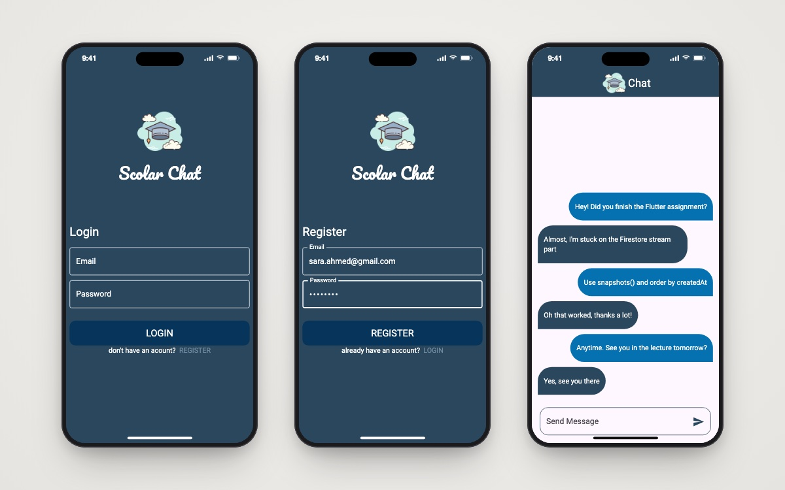

<h1 align="center">Scholar Chat</h1>

<p align="center">A real-time group chat app built with Flutter, Firebase Auth, Cloud Firestore and Cubit.</p>

<p align="center">
  
  
  
  
  
</p>

<p align="center">
  
  <br/><sub>Login · Register · Chat</sub>
</p>

## 📖 About

Scholar Chat is a real-time chat room built while learning Firebase and state management in Flutter. Users register or log in with email and password, then join a shared room where messages stream live from **Cloud Firestore**. The app started with `setState` and was refactored to **Cubit**: login, registration and chat each have their own Cubit, and a `BlocObserver` logs every state change.

## ✨ Features

- 📝 **Register and login** with Firebase Auth (email/password), with form validation and readable error snack bars.
- ⏳ **Loading overlay** during auth calls (`modal_progress_hud_nsn`).
- ⚡ **Live messages**: a Firestore `snapshots()` stream ordered by `createdAt`.
- 💬 **Chat bubbles** that tell your messages apart from other people's, in a reversed list that scrolls to the newest message.
- 🧩 **Cubit architecture**: `LoginCubit`, `RegisterCubit`, `ChatCubit` and a `SimpleBlocObserver`.

## 🛠 Tech stack

- **Flutter / Dart** (SDK `^3.5.0`)
- **State management:** `bloc`, `flutter_bloc` (Cubit)
- **Backend:** `firebase_core`, `firebase_auth`, `cloud_firestore`
- **UX:** `modal_progress_hud_nsn`

## 🏗 Project structure

```
lib/
├── cubit/          # Chat_cubit, login cubit, register_cubit (+ states)
├── Models/         # Message model
├── pages/          # Login, Register, Chat
├── widgets/        # chat bubbles, button, text field
├── helper/         # snack-bar helper
├── bloc_Observer.dart
├── constant_file.dart
├── firebase_options.dart
└── main.dart
```

## 🚀 Getting started

**Prerequisites:** Flutter SDK and a Firebase project with **Email/Password** auth and **Cloud Firestore** enabled.

```bash
git clone https://github.com/youssef336/Chat_app.git
cd Chat_app
flutter pub get
flutterfire configure   # point lib/firebase_options.dart at your own Firebase project
flutter run
```

Messages are stored in the Firestore collection `messages` with the fields `message`, `createdAt` and `id` (the sender's email).

## 👤 Author

**Youssef Belal Zakaria** · [GitHub @youssef336](https://github.com/youssef336)

⭐ If you like this project, give it a star!
